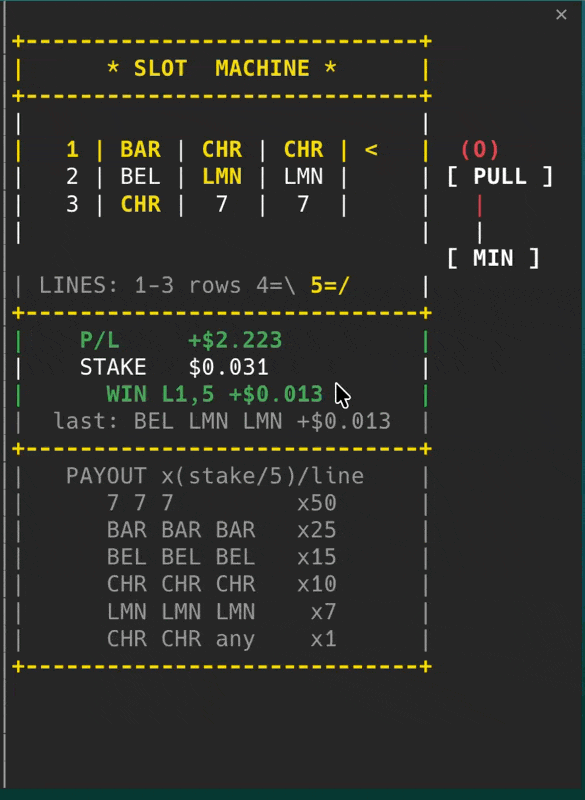

# Claude Code Slot Machine

An ASCII slot machine that lives in a pane beside your Claude Code conversation.
Every prompt you send pulls the lever, and **the API cost of that turn is your stake**.



## Features

- 3x3 reels with 5 paylines: three rows and two diagonals
- Spins on every prompt you submit; the stake is the session cost added by that turn (subagents included)
- Running profit/loss, kept across sessions
- Free spins with the lever (`l`) or `/slot`
- Minimize with `MIN` (`m`) or by closing the pane: prompts keep spinning in the background, wins pop a toast and the status line keeps the last result and P/L; `/slot` brings the pane back
- RTP drawn per session between 92.5% and 97.5%
- Three win tiers (win, big win, jackpot) with their own animation and sound
- Stays 40 columns wide so the conversation keeps its room

## Install

In a Claude Code terminal session:

```
/plugin install slot-machine --marketplace TWKiwi/claude-code-slot-machine
```

Answer `y` to add the marketplace, then pick a scope.

## Requirements

- The pane docks beside the transcript in the fullscreen layout. It opens by itself at 144+ columns; at any width, `/slot` opens it.
- Sound plays on macOS only.

## Credits

Sounds are CC0 assets by [Kenney](https://kenney.nl), see [CREDITS.md](CREDITS.md).

## License

MIT
